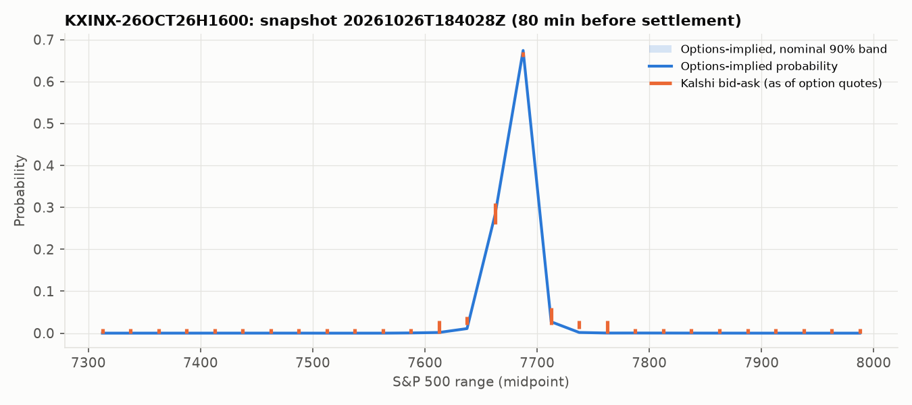
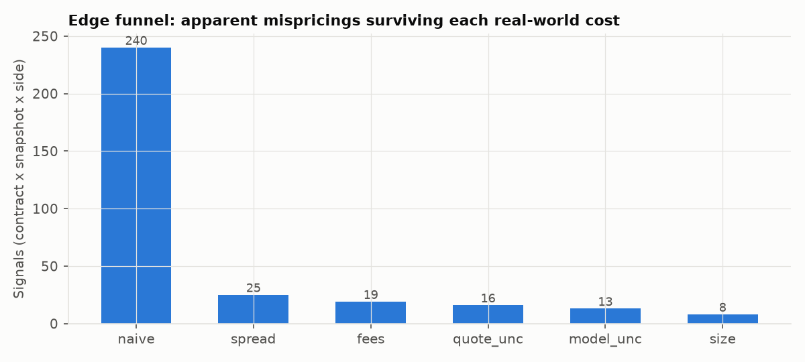

# Kalshi vs options: research report
_Generated 2026-10-26 19:28 UTC by `python -m kme report`. Every figure below is computed from files in `data/`; sections without enough data say so._

## Data coverage
- Panel rows: 660 (660 live, 0 backfill); rows without a synchronised Kalshi quote: 2
- Candle-replay check (candle state at fetch time == live book, live rows): 95.4% of 658 rows agree
- Snapshots: 16; events: 11; first decision 2026-10-09T19:44:21.670578+00:00, last 2026-10-26T18:56:20.053836+00:00
- Settled events with outcomes: 10
- Smile model chosen: {'spline': 15, 'svi': 1}

## Edge funnel
Stages are cumulative (see `src/kme/edge.py`). Kalshi prices are synchronised to the option chain's as-of time, so this measures mispricing; it is a tradeable backtest only with a real-time option feed. Model-error tolerance = 0.0021 (range contracts, same-day only). P&L is per contract after fees, t-stat clusters by event day, shown only with >= 40 settled event days.

| stage     |   signals |   contracts_distinct |   event_days |   settled_signals |   settled_days |   mean_pnl |   hit_rate |   daily_mean |   t_stat |
|:----------|----------:|---------------------:|-------------:|------------------:|---------------:|-----------:|-----------:|-------------:|---------:|
| naive     |       240 |                  113 |           11 |               235 |             10 |        nan |        nan |          nan |      nan |
| spread    |        25 |                   24 |           10 |                23 |              9 |        nan |        nan |          nan |      nan |
| fees      |        19 |                   19 |           10 |                17 |              9 |        nan |        nan |          nan |      nan |
| quote_unc |        16 |                   16 |           10 |                14 |              9 |        nan |        nan |          nan |      nan |
| model_unc |        13 |                   13 |            9 |                11 |              8 |        nan |        nan |          nan |      nan |
| size      |         8 |                    8 |            8 |                 7 |              7 |        nan |        nan |          nan |      nan |

## Which forecast was better? (log score on the realised range)
```
{
  "n_events": 6,
  "note": "insufficient data (n=6, need >= 40 settled events)"
}
```

## Risk premium or mispricing? (pricing-kernel tilt)
- Snapshots with a full partition + density grid: 7
- theta_kalshi: insufficient data (n=7, need >= 40)
- theta_realized: {"n": 6, "note": "insufficient data (n=6, need >= 40)"}

## Figures




